# Практическая работа. Транзакции, ACID, уровни изоляции и блокировки

Работа с транзакциями (BEGIN/COMMIT/ROLLBACK, SAVE TRANSACTION, @@TRANCOUNT), блокировками и взаимоблокировками, свойствами ACID и уровнями изоляции.

---

# Часть 1 (24.09.26). Основы транзакций

## Задание 1. BEGIN TRANSACTION и COMMIT


### Что требовалось
Показать фиксацию транзакции: добавить запись в таблицу AUDITORIUM внутри транзакции и зафиксировать её.

### Что сделано
Внутри транзакции подсчитано количество строк, добавлена аудитория, снова подсчитано количество строк, выполнен COMMIT и сделан итоговый подсчёт.

```sql
BEGIN TRANSACTION;

SELECT COUNT(*) FROM AUDITORIUM;

INSERT INTO AUDITORIUM VALUES ('123-1', 'ЛК', 60, '123-1');

SELECT COUNT(*) FROM AUDITORIUM;

COMMIT;

SELECT COUNT(*) FROM AUDITORIUM;
```

### Вывод
После COMMIT добавленная запись остаётся в таблице.

---

## Задание 2. ROLLBACK


### Что требовалось
Показать откат транзакции.

### Что сделано
Внутри транзакции добавлена аудитория, количество строк проверено до и после вставки, затем выполнен ROLLBACK и сделан итоговый подсчёт.

```sql
BEGIN TRANSACTION;

SELECT COUNT(*) FROM AUDITORIUM;

INSERT INTO AUDITORIUM VALUES ('124-1', 'ЛК', 60, '124-1');

SELECT COUNT(*) FROM AUDITORIUM;

ROLLBACK;

SELECT COUNT(*) FROM AUDITORIUM;
```

### Результат


### Вывод
После ROLLBACK количество строк возвращается к исходному: вставка отменена.

---

## Задание 3. SAVE TRANSACTION


### Что требовалось
Показать частичный откат транзакции с помощью точек сохранения.

### Что сделано
В одной транзакции вставлены четыре аудитории с точками сохранения A и B между ними. После третьей вставки выполнен откат к B, после четвёртой — откат к A, затем COMMIT.

```sql
BEGIN TRANSACTION;

INSERT INTO AUDITORIUM VALUES ('999-1', 'ЛК', 60, '999-1');
SAVE TRANSACTION A;

INSERT INTO AUDITORIUM VALUES ('999-2', 'ЛК', 60, '999-2');
SAVE TRANSACTION B;

INSERT INTO AUDITORIUM VALUES ('999-3', 'ЛК', 60, '999-3');
ROLLBACK TRANSACTION B;

INSERT INTO AUDITORIUM VALUES ('999-4', 'ЛК', 60, '999-4');
ROLLBACK TRANSACTION A;

COMMIT TRANSACTION;

SELECT * FROM AUDITORIUM
WHERE AUDITORIUM IN('999-1', '999-2', '999-3', '999-4');
```

### Результат


### Анализ
Откат к точке B отменил вставку 999-3, откат к точке A отменил всё, что было после A (999-2 и 999-4). После COMMIT сохранилась только запись 999-1.

### Вывод
Откат к точке сохранения отменяет только часть транзакции, оставляя предыдущую работу.

---

## Задание 4. @@TRANCOUNT


### Что требовалось
Показать, как меняется @@TRANCOUNT при вложенных транзакциях.

### Что сделано
Открыта внешняя транзакция A, затем вложенная транзакция B. На каждом шаге выводится количество строк и значение @@TRANCOUNT.

```sql
-- Шаг 1: Транзакций нет (@@TRANCOUNT = 0)
SELECT COUNT(*) '1', @@TRANCOUNT 'TRANCOUNT' FROM AUDITORIUM;
BEGIN TRANSACTION A;

-- Шаг 2: Открыта первая транзакция (@@TRANCOUNT = 1)
INSERT INTO AUDITORIUM VALUES ('128-1', 'ЛК', 60, '128-1');
SELECT COUNT(*) '2', @@TRANCOUNT 'TRANCOUNT' FROM AUDITORIUM;

BEGIN TRANSACTION B;

-- Шаг 3: Открыта вложенная транзакция (@@TRANCOUNT = 2)
DELETE AUDITORIUM WHERE AUDITORIUM = '128-1';
SELECT COUNT(*) '3', @@TRANCOUNT 'TRANCOUNT' FROM AUDITORIUM;

COMMIT TRANSACTION B;

-- Шаг 4: Вложенная транзакция закрыта, но внешняя еще активна (@@TRANCOUNT = 1)
SELECT COUNT(*) '4', @@TRANCOUNT 'TRANCOUNT' FROM AUDITORIUM;

-- Шаг 5: Снова вставляем запись
INSERT INTO AUDITORIUM VALUES ('128-1', 'ЛК', 60, '128-1');
SELECT COUNT(*) '5', @@TRANCOUNT 'TRANCOUNT' FROM AUDITORIUM;

COMMIT TRANSACTION A;

-- Шаг 6: Все транзакции закрыты, данные зафиксированы (@@TRANCOUNT = 0)
SELECT COUNT(*) '6', @@TRANCOUNT 'TRANCOUNT' FROM AUDITORIUM;
```

### Результат


### Анализ
Каждый BEGIN TRANSACTION увеличивает @@TRANCOUNT на 1, каждый COMMIT уменьшает на 1. Данные фиксируются окончательно, только когда счётчик возвращается к 0.

### Вывод
COMMIT вложенной транзакции не фиксирует данные окончательно — это делает только COMMIT внешней.

---

## Задание 5. Блокировки


### Что требовалось
Посмотреть текущие блокировки сервера.

### Что сделано
Выполнен запрос к представлению sys.dm_tran_locks.

```sql
SELECT resource_type,
DB_NAME(resource_database_id) as database_name,
request_session_id, request_mode,
request_status
FROM sys.dm_tran_locks;
```

### Результат


### Вывод
sys.dm_tran_locks показывает, какие ресурсы заблокированы, какими сессиями и в каком режиме.

---

## Задание 6. Взаимоблокировки (deadlock)


### Что требовалось
Смоделировать взаимоблокировку двух транзакций.

### Что сделано
Две транзакции в разных сессиях блокируют две аудитории в обратном порядке. Каждая сначала обновляет «свою» аудиторию, ждёт 10 секунд, затем пытается обновить аудиторию другой транзакции.

Сессия 1:
```sql
USE College;
GO

BEGIN TRANSACTION;
-- Блокируем первую аудиторию
UPDATE AUDITORIUM
	SET AUDITORIUM_CAPACITY = 70
	WHERE AUDITORIUM = '999-1';

-- ожидание
WAITFOR DELAY '00:00:10';

-- Пытаемся заблокировать вторую аудиторию
UPDATE AUDITORIUM
	SET AUDITORIUM_CAPACITY = 80
	WHERE AUDITORIUM = '999-2';
COMMIT;
```

Сессия 2:
```sql
USE College;
GO

BEGIN TRANSACTION;
-- Блокируем вторую аудиторию
UPDATE AUDITORIUM
	SET AUDITORIUM_CAPACITY = 70
	WHERE AUDITORIUM = '999-2';

-- ожидание
WAITFOR DELAY '00:00:10';

-- Пытаемся заблокировать первую аудиторию
UPDATE AUDITORIUM
	SET AUDITORIUM_CAPACITY = 80
	WHERE AUDITORIUM = '999-1';
COMMIT;
```

### Результат


### Анализ
Каждая транзакция держит блокировку, нужную другой, и ждёт чужую. SQL Server обнаруживает цикл ожидания и завершает одну из транзакций ошибкой, выбрав её «жертвой» (deadlock victim).

### Вывод
Чтобы избежать взаимоблокировок, транзакции должны обращаться к ресурсам в одном и том же порядке.

---

# Часть 2 (25.09.26). Транзакции: практические задачи (база College2)

## Задача 1.1. Зачисление студента на курс

### Что требовалось
Студент записывается на курс. Необходимо: добавить запись в Enrollments; уменьшить доступное количество мест на курсе (добавить столбец SeatsAvailable); если мест нет — вся операция откатывается.

### Что сделано
В транзакции места проверяются с блокировкой строки курса (UPDLOCK), чтобы другие транзакции не изменили её до конца текущей. Если мест нет — откат, иначе добавляется запись о зачислении и уменьшается SeatsAvailable. Ошибки перехватываются в CATCH с откатом.

```sql
DECLARE @StudentId INT = 1;
DECLARE @CourseId INT = 2; 
DECLARE @Semester NVARCHAR(20) = '2026-Осень';

BEGIN TRY
    BEGIN TRANSACTION;

    DECLARE @Available INT;
    -- проверка мест и блокировки строку от изменения другими транзакциями до конца нынешней
    SELECT @Available = SeatsAvailable 
    FROM Courses WITH (UPDLOCK) 
    WHERE CourseId = @CourseId;

    IF @Available <= 0
    BEGIN
        PRINT 'Нет доступных мест. Откат операции.';
        ROLLBACK TRANSACTION;
    END
    ELSE
    BEGIN
        -- ДОбавление записи о зачислении
        INSERT INTO Enrollments (StudentId, CourseId, Semester)
        VALUES (@StudentId, @CourseId, @Semester);

        -- Уменьшени кол-ва мест
        UPDATE Courses
        SET SeatsAvailable = SeatsAvailable - 1
        WHERE CourseId = @CourseId;

        COMMIT TRANSACTION;
        PRINT 'Студент успешно зачислен!';
    END
END TRY
BEGIN CATCH
    IF @@TRANCOUNT > 0 
        ROLLBACK TRANSACTION;
    PRINT 'Ошибка: ' + ERROR_MESSAGE();
END CATCH;
```

### Результат
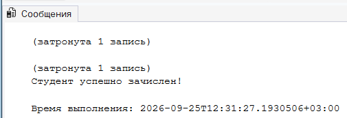

### Вывод
UPDLOCK при проверке мест защищает от одновременного зачисления на последнее место.

---

## Задача 1.2. Перевод студента в другую группу

### Что требовалось
Атомарно: изменить GroupId в Students и создать запись в AuditLog о переводе. Если лог не записался — перевод отменяется.

### Что сделано
В одной транзакции выполняются UPDATE группы студента и INSERT записи в AuditLog. При любой ошибке в CATCH транзакция откатывается.

```sql
DECLARE @TransferStudentId INT = 2;
DECLARE @NewGroupId INT = 3;

BEGIN TRY
    BEGIN TRANSACTION;

    -- замена группы студенту
    UPDATE Students
    SET GroupId = @NewGroupId
    WHERE StudentId = @TransferStudentId;

    -- запись события в аудитлог
    INSERT INTO AuditLog (EventType, TableName, RecordId, Message)
    VALUES (
        'Transfer', 
        'Students', 
        @TransferStudentId, 
        'Студент переведен в группу ' + CAST(@NewGroupId AS NVARCHAR(10))
    );

    COMMIT TRANSACTION;
    PRINT 'Перевод выполнен, лог записан!';
END TRY
BEGIN CATCH
    -- При возникновении ошибки откатываем все
    IF @@TRANCOUNT > 0 
        ROLLBACK TRANSACTION;
    PRINT 'Сбой! Транзакция отменена. Причина: ' + ERROR_MESSAGE();
END CATCH;
```

### Результат
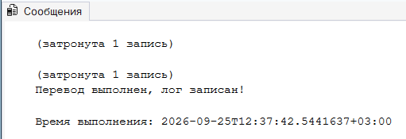

### Вывод
Транзакция гарантирует, что перевод и запись в журнал выполняются вместе или не выполняются вовсе.

---

## Задача 1.3. Мониторинг активных транзакций

### Что требовалось
Найти все активные транзакции в БД университета, работающие дольше 10 секунд.

### Что сделано
Выполнен запрос к системным представлениям sys.dm_tran_active_transactions, sys.dm_tran_session_transactions и sys.dm_tran_database_transactions с фильтром по длительности и базе College2.

```sql
SELECT 
    st.session_id AS [ID Сессии],
    at.transaction_id AS [ID Транзакции],
    at.transaction_begin_time AS [Время начала],
    DATEDIFF(SECOND, at.transaction_begin_time, GETDATE()) AS [Длительность (сек)],
    DB_NAME(dt.database_id) AS [База данных]
FROM sys.dm_tran_active_transactions at
JOIN sys.dm_tran_session_transactions st ON at.transaction_id = st.transaction_id
JOIN sys.dm_tran_database_transactions dt ON at.transaction_id = dt.transaction_id
WHERE DATEDIFF(SECOND, at.transaction_begin_time, GETDATE()) > 10
  AND DB_NAME(dt.database_id) = 'College2';
```

### Результат
Зависших транзакций нет.

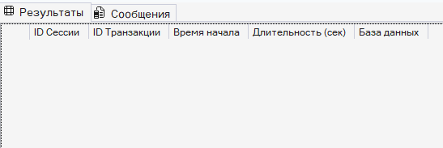

### Вывод
Такой запрос помогает находить «зависшие» длительные транзакции, держащие блокировки.

---

## Задача 2.1. Atomicity (атомарность)

### Что требовалось
Выставление итоговой оценки студенту должно одновременно записать оценку в Grades и обновить Enrollments.Status = 'Завершён'. Смоделировать ошибку на втором шаге (например, через искусственный CHECK) и убедиться, что оценка тоже не сохранилась.

### Что сделано
Добавлено искусственное ограничение CHK_SimulateError (WITH NOCHECK, чтобы игнорировать старые записи и срабатывать только на новые). В транзакции вставлена оценка, затем обновление статуса нарушает ограничение. Ошибка перехвачена, транзакция откачена, проверено отсутствие оценки в Grades, ограничение удалено.

```sql
USE College2;
GO

-- На всякий случай удаляем ограничение, если оно вдруг где-то зависло
IF EXISTS (SELECT * FROM sys.check_constraints WHERE name = 'CHK_SimulateError')
    ALTER TABLE Enrollments DROP CONSTRAINT CHK_SimulateError;
GO

-- искусственная ошибка
-- WITH NOCHECK заставляет SQL Server игнорировать старые записи и ругаться только на новые
ALTER TABLE Enrollments WITH NOCHECK ADD CONSTRAINT CHK_SimulateError CHECK (Status <> 'Завершён');
GO

-- 2. Запускаем транзакцию
BEGIN TRY
    BEGIN TRANSACTION;

    -- 1. Добавляем оценку
    INSERT INTO Grades (StudentId, CourseId, Grade)
    VALUES (1, 1, 5);
    
    PRINT 'Оценка добавлена в память транзакции.';

    -- 2. Пытаемся обновить статус
    UPDATE Enrollments
    SET Status = 'Завершён'
    WHERE StudentId = 1 AND CourseId = 1;

    COMMIT TRANSACTION;
    PRINT 'Операция успешна!';
END TRY
BEGIN CATCH
    -- 3 ошибка перехватывается, и происходит ролбэк
    IF @@TRANCOUNT > 0 
        ROLLBACK TRANSACTION;
    PRINT 'Произошла ошибка, транзакция отменена. Оценка не сохранилась!';
    PRINT ERROR_MESSAGE();
END CATCH;
GO

-- Проверяем, на отсутствие оценки(атомарность)
SELECT * FROM Grades WHERE StudentId = 1 AND CourseId = 1 AND Grade = 5;
GO

ALTER TABLE Enrollments DROP CONSTRAINT CHK_SimulateError;
GO
```

### Результат
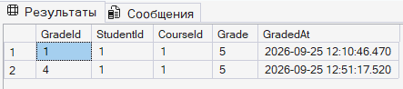

### Вывод
Ошибка на втором шаге откатила и первый: оценка в Grades не сохранилась — атомарность соблюдена.

---

## Задача 2.2. Consistency (согласованность)

### Что требовалось
Добавить ограничение: студент не может быть записан на курс дважды в одном семестре.

### Что сделано
В таблицу Enrollments добавлено ограничение уникальности по сочетанию (StudentId, CourseId, Semester).

```sql
ALTER TABLE Enrollments 
ADD CONSTRAINT UQ_Student_Course_Semester UNIQUE (StudentId, CourseId, Semester);
GO
```

### Результат
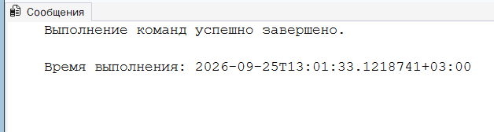

### Вывод
Ограничения целостности на уровне БД не дают привести данные в несогласованное состояние.

---

## Задача 2.3. Isolation (изолированность)

### Что требовалось
Две сессии одновременно пытаются записать последнего студента на курс (мест = 1). Показать, как без правильных блокировок могут записаться двое.

### Что сделано
Подготовлен курс с одним свободным местом. В двух вкладках запущен код: каждая читает количество мест (читающая блокировка тут же снимается), проверяет, что место есть, и записывает студента. Первая вкладка делает паузу в 5 секунд, поэтому вторая успевает прочитать то же значение.

Подготовка:
```sql
UPDATE Courses SET SeatsAvailable = 1 WHERE CourseId = 1;
```

Вкладка 1:
```sql
BEGIN TRAN;
DECLARE @Available INT;

-- Читаем: мест = 1. Блокировка чтения тут же снимается.
SELECT @Available = SeatsAvailable FROM Courses WHERE CourseId = 1;

-- Ждем 5 секунд (имитация долгого раздумья программы)
WAITFOR DELAY '00:00:05'; 

IF @Available > 0
BEGIN
    INSERT INTO Enrollments (StudentId, CourseId, Semester) VALUES (3, 1, '2026-Осень');
    UPDATE Courses SET SeatsAvailable = SeatsAvailable - 1 WHERE CourseId = 1;
    PRINT 'Студент 3 зачислен!';
END
COMMIT TRAN;
```

Вкладка 2:
```sql
BEGIN TRAN;
DECLARE @Available INT;

-- Читаем: мест = 1, так как первая сессия еще не сделала UPDATE
SELECT @Available = SeatsAvailable FROM Courses WHERE CourseId = 1;

IF @Available > 0
BEGIN
    INSERT INTO Enrollments (StudentId, CourseId, Semester) VALUES (4, 1, '2026-Осень');
    UPDATE Courses SET SeatsAvailable = SeatsAvailable - 1 WHERE CourseId = 1;
    PRINT 'Студент 4 зачислен!';
END
COMMIT TRAN;
```

### Результат
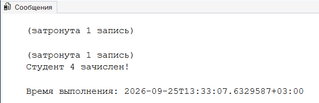

### Анализ
Обе сессии прочитали «мест = 1» до того, как кто-либо уменьшил счётчик, поэтому обе зачислили студента. Без UPDLOCK (как в задаче 1.1) или более строгого уровня изоляции возникает гонка.

### Вывод
Проверка и изменение должны выполняться под защитой блокировки, иначе нарушается изолированность.

---

## Задача 2.4. Durability (надёжность)

### Что требовалось
После COMMIT оценка студента сохраняется даже при перезапуске SQL Server. Объяснить роль журнала транзакций (LDF) на примере.

### Что сделано
Разобран механизм Write-Ahead Logging на примере.

### Анализ
Надёжность гарантирует, что если транзакция сообщила об успехе (выполнился COMMIT), данные не потеряются, даже если сервер обесточат. Это достигается механизмом Write-Ahead Logging (WAL) и файлом журнала транзакций (.ldf).

**Пример:**
1. Преподаватель ставит оценку «5», код доходит до COMMIT.
2. В эту же миллисекунду SQL Server синхронно записывает операцию в файл журнала (LDF) на диске. Журнал работает быстро, так как пишет строго последовательно.
3. Сама оценка в главный файл данных (MDF) на диск ещё не записалась и висит в оперативной памяти (в кэше).
4. Сервер обесточивается.
5. Сервер перезапускается, SQL Server запускает процесс восстановления (Recovery). Он читает .ldf, видит зафиксированную транзакцию с отметкой COMMIT и накатывает оценку (операция Redo) в файл MDF. Оценка сохранена.

### Вывод
Журнал транзакций позволяет восстановить зафиксированные данные после сбоя.

---

## Задача 3.1. READ UNCOMMITTED (грязное чтение)

### Что требовалось
Деканат вносит новую оценку, но ещё не закоммитил. Студент смотрит ведомость и видит «2», хотя преподаватель передумал и откатит. Воспроизвести, сделать вывод о рисках.

### Что сделано
В первой вкладке начата транзакция с вставкой оценки 2 без COMMIT. Во второй вкладке выполнено чтение с хинтом NOLOCK (равнозначно READ UNCOMMITTED) — студент видит оценку 2. Затем первая вкладка откатывает транзакцию.

Вкладка 1:
```sql
USE College2;
GO
BEGIN TRAN;
-- Преподаватель случайно ставит двойку
INSERT INTO Grades (StudentId, CourseId, Grade) VALUES (1, 1, 2);
-- ТРАНЗАКЦИЯ НЕ ЗАКРЫТА! Переходи во вкладку 2.
```

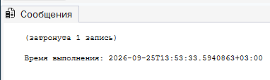

Вкладка 2:
```sql
USE College2;
GO
-- Хинт WITH (NOLOCK) работает так же, как уровень изоляции READ UNCOMMITTED
SELECT * FROM Grades WITH (NOLOCK) WHERE StudentId = 1; 
-- Студент видит оценку 2 и паникует. Переходи обратно во вкладку 1.
```

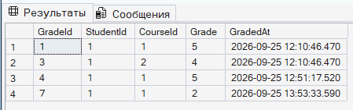

Вкладка 1:
```sql
ROLLBACK;
```

### Вывод
Грязное чтение чревато фатальными ошибками в бизнес-логике. На основе «фантомной» двойки автоматическая система могла бы лишить студента стипендии или отправить приказ на отчисление, хотя в реальности этой оценки в базе никогда не существовало.

---

## Задача 3.2. READ COMMITTED (non-repeatable read)

### Что требовалось
Студент дважды читает свою среднюю оценку во время сессии. Между чтениями преподаватель выставляет новую оценку.

### Что сделано
Первая сессия читает среднюю оценку, вторая вставляет новую оценку, первая читает среднюю оценку повторно — значение изменилось.

Сессия 1:
```sql
SET TRANSACTION ISOLATION LEVEL READ COMMITTED;
BEGIN TRAN;
SELECT AVG(Grade) FROM Grades WHERE StudentId = 1; -- например 4.0
```

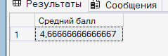

Сессия 2:
```sql
INSERT INTO Grades VALUES (1, 11, 5); -- новая оценка
```

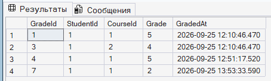

Сессия 1:
```sql
SELECT AVG(Grade) FROM Grades WHERE StudentId = 1; -- уже 4.3

COMMIT;
```

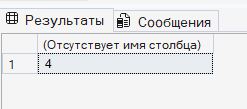

### Анализ
READ COMMITTED не удерживает блокировку чтения до конца транзакции, поэтому между двумя SELECT другая сессия может изменить данные.

### Вывод
На уровне READ COMMITTED возможно неповторяющееся чтение (non-repeatable read).

---

## Задача 3.3. REPEATABLE READ (phantom read)

### Что требовалось
Деканат формирует список студентов группы ИС-21. Пока он читает, приходит перевод нового студента в эту группу.

### Что сделано
Первая сессия под REPEATABLE READ подсчитывает студентов группы, вторая добавляет нового студента, первая повторяет подсчёт.

```sql
SET TRANSACTION ISOLATION LEVEL REPEATABLE READ;
BEGIN TRAN;
SELECT COUNT(*) FROM Students WHERE GroupId = 5; -- 20
```

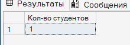

```sql
INSERT INTO Students (FullName, GroupId, EnrolledYear) VALUES (N'Новенький Н.Н.', 1, 2026);
```

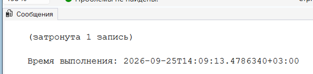

```sql
SELECT COUNT(*) FROM Students WHERE GroupId = 5; -- 21 → фантом
COMMIT;
```

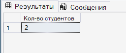

### Анализ
REPEATABLE READ блокирует уже прочитанные строки, но не защищает от появления новых строк, подходящих под условие. Поэтому повторный запрос видит «фантомную» строку.

### Вывод
REPEATABLE READ защищает от неповторяющегося чтения, но не от фантомов.

---

## Задача 3.4. SERIALIZABLE

### Что требовалось
Проверка, что в группе не больше 25 студентов. Запрос и вставка должны быть защищены от гонок.

### Что сделано
В первой вкладке под SERIALIZABLE выполняется проверка количества студентов в группе. Вторая вкладка пытается вставить студента в эту же группу и зависает. После вставки и COMMIT в первой вкладке вторая вкладка продолжает работу.

Вкладка 1:
```sql
SET TRANSACTION ISOLATION LEVEL SERIALIZABLE;
BEGIN TRAN;
-- SERIALIZABLE вешает блокировку диапазона ключей (Range Lock).
IF (SELECT COUNT(*) FROM Students WHERE GroupId = 2) < 25
    PRINT 'Места есть, начинаем оформление...';
```

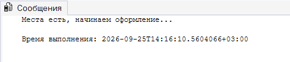

Вкладка 2:
```sql
-- Этот запрос "зависнет" (уйдет в ожидание), потому что Сессия 1 заблокировала диапазон GroupId = 2.
INSERT INTO Students (FullName, GroupId, EnrolledYear) VALUES (N'Тестовый Т.Т.', 2, 2026);
```

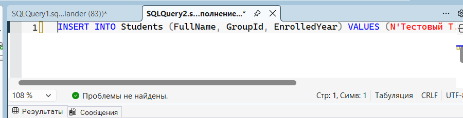

Вкладка 1:
```sql
INSERT INTO Students (FullName, GroupId, EnrolledYear) VALUES (N'Первый П.П.', 2, 2026);
COMMIT;
```

После выполнения запроса запрос во второй вкладке «отвис».

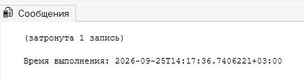

### Анализ
SERIALIZABLE накладывает блокировку диапазона ключей, поэтому другая сессия не может вставить подходящую строку, пока транзакция не завершится.

### Вывод
SERIALIZABLE полностью устраняет фантомы и гонки, но снижает параллелизм.

---

## Задача 3.5. SNAPSHOT

### Что требовалось
Отчёт по успеваемости факультета должен читаться согласованно, без блокировки текущих операций выставления оценок.

### Что сделано
Для базы включена поддержка версионирования строк. В первой вкладке под SNAPSHOT начата транзакция чтения. Во второй вкладке вставка оценки выполнилась мгновенно, без ожидания.

```sql
ALTER DATABASE College2 SET ALLOW_SNAPSHOT_ISOLATION ON;
GO
```

Вкладка 1:
```sql
SET TRANSACTION ISOLATION LEVEL SNAPSHOT;
BEGIN TRAN;
-- Аналитик читает согласованный срез данных на момент старта транзакции. 
-- Чтение не накладывает блокировки (S-locks).
SELECT * FROM Grades g JOIN Students s ON g.StudentId = s.StudentId;
```

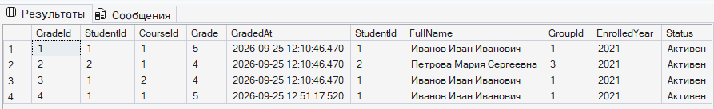

Вкладка 2:
```sql
-- Запрос выполнится мгновенно, не ожидая аналитика, так как блокировок нет.
INSERT INTO Grades (StudentId, CourseId, Grade) VALUES (2, 1, 4);
```

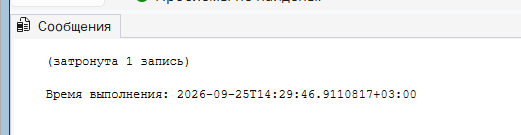

Вкладка 1:
```sql
COMMIT;
```

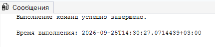

### Анализ
SNAPSHOT использует версии строк, поэтому читатели не блокируют писателей и наоборот, а чтение остаётся согласованным на момент начала транзакции.

### Вывод
SNAPSHOT подходит для длинных отчётов, не мешающих текущим операциям.

---

## Задача 3.6. Сравнение уровней изоляции

### Что требовалось
Подобрать уровень изоляции для типовых операций деканата.

### Что сделано
Составлена таблица рекомендаций.

### Результат

| Операция | Рекомендуемый уровень | Обоснование |
| :--- | :--- | :--- |
| **Чтение ведомости студентом** | `READ COMMITTED` | Достаточно видеть только зафиксированные данные. Если нужно, чтобы чтение ведомостей (сотни студентов) не блокировало работу преподавателей, идеально подойдёт `SNAPSHOT` (если включён в БД). |
| **Выставление оценки** | `READ COMMITTED` | Стандартная запись. Блокировки конкретной строки (Row Lock) достаточно, чтобы две сессии не мешали друг другу. |
| **Формирование расписания сессии** | `SERIALIZABLE` | Необходимо защититься от фантомных вставок, чтобы два разных диспетчера параллельно не поставили два экзамена в одну и ту же аудиторию в одно и то же время. |
| **Расчёт стипендии** | `SNAPSHOT` или `REPEATABLE READ` | Финансовые расчёты требуют строгой консистентности. Пока идёт расчёт средних баллов по всему потоку, ни одна оценка не должна измениться (защита от неповторяющегося чтения). `SNAPSHOT` предпочтительнее, так как не заблокирует базу для других пользователей на время расчёта. |

---

## Задача 4.1. Анализ блокировок текущей сессии

### Что требовалось
Посмотреть, какие блокировки выдаёт SQL Server текущей сессии при изменении данных.

### Что сделано
В транзакции обновлена оценка, затем через sys.dm_tran_locks выведены блокировки текущей сессии (@@SPID), после чего транзакция откатана, чтобы снять блокировки.

```sql
USE College2;
GO

BEGIN TRAN;

-- 1 Обновляем оценку (вешаем блокировку)
UPDATE Grades 
SET Grade = 4 
WHERE StudentId = 1 AND CourseId = 1;

-- 2 Смотрим, какие блокировки выдал нам SQL Server
SELECT 
    request_session_id AS [ID сессии], 
    resource_type AS [Уровень блокировки], 
    resource_description AS [Описание ресурса],
    request_mode AS [Тип блокировки (Mode)], 
    request_status AS [Статус]
FROM sys.dm_tran_locks
WHERE request_session_id = @@SPID;

-- 3 Откатываем транзакцию, чтобы снять блокировки
ROLLBACK;
```

### Результат
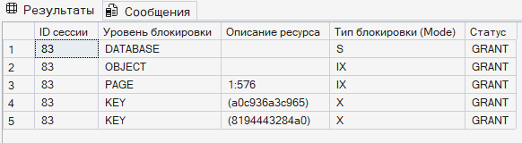

### Вывод
Изменение строки накладывает блокировки на разных уровнях (ключ, страница, таблица), которые снимаются после завершения транзакции.

<!-- Примечание автора из исходного файла: «Не успел дальше» — задачи после 4.1 не выполнены -->

---

## Общий вывод

| Задание | Что показал |
|---|---|
| Часть 1, 1–2 | COMMIT и ROLLBACK |
| Часть 1, 3–4 | SAVE TRANSACTION и @@TRANCOUNT |
| Часть 1, 5–6 | Блокировки и взаимоблокировки |
| Часть 2, 1.1–1.3 | Транзакции в прикладных сценариях, мониторинг |
| Часть 2, 2.1–2.4 | Свойства ACID: Atomicity, Consistency, Isolation, Durability |
| Часть 2, 3.1–3.6 | Уровни изоляции и аномалии чтения |
| Часть 2, 4.1 | Анализ блокировок через sys.dm_tran_locks |

**Ключевые принципы:**
1. Atomicity — всё или ничего.
2. Consistency — ограничения (CHECK, UNIQUE) охраняют согласованность.
3. Isolation — уровни изоляции защищают от грязного чтения, неповторяющегося чтения и фантомов.
4. Durability — COMMIT фиксируется через журнал транзакций (WAL).
5. SNAPSHOT — согласованное чтение без блокировок.

**Уровни изоляции:**

| Уровень | Грязное чтение | Неповторяющееся чтение | Фантомы |
|---|---|---|---|
| READ UNCOMMITTED | возможно | возможно | возможны |
| READ COMMITTED | нет | возможно | возможны |
| REPEATABLE READ | нет | нет | возможны |
| SERIALIZABLE | нет | нет | нет |
| SNAPSHOT | нет | нет | нет |

---

## Стек

Microsoft SQL Server 2017, SSMS 22, базы College, College2.
