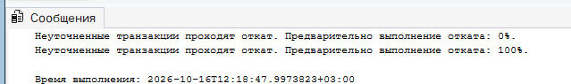
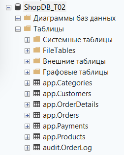
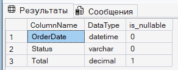
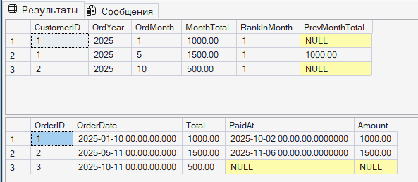
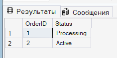
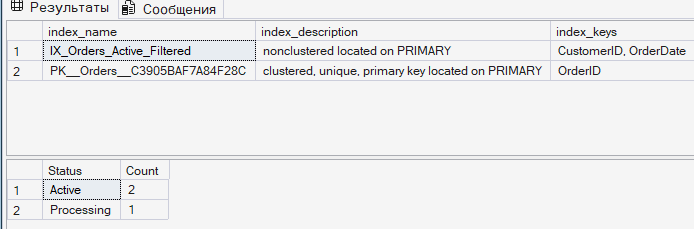

### Создание БД ```ShopDB_T02```
```sql
CREATE DATABASE ShopDB_T02;
GO
```

---

## Включение REAF_COMMITED_SNAPSHOT
```sql
USE master;
GO

USE ShopDB_T02;
GO

ALTER DATABASE ShopDB_T02 SET READ_COMMITTED_SNAPSHOT ON WITH ROLLBACK IMMEDIATE;
GO
```
> Выполнено успешно:
> 

---

### Задание 1
Надо создать таблицы с ошибками
**В таблицах ```app.Orders```**
1. Поле ```OrderDate``` имеет тип ```DATETIME``` вместо ```DATETIME2```.
2. Поле ```Status``` иммет тип VARCHAR вместо NVARCHAR.
3. Поле ```Total``` допускает ```NULL```, хотя ожидается ```NOT NULL```.

**В таблице ```app.OrderDetails``` пропущен внешний ключ на ```app.Products```**.

```sql
-- 1. Категории
CREATE TABLE app.Categories (
    CategoryID INT IDENTITY(1,1) PRIMARY KEY,
    ParentID INT NULL FOREIGN KEY REFERENCES app.Categories(CategoryID),
    Name NVARCHAR(100) NOT NULL
);

-- 2. Товары
CREATE TABLE app.Products (
    ProductID INT IDENTITY(1,1) PRIMARY KEY,
    CategoryID INT NOT NULL FOREIGN KEY REFERENCES app.Categories(CategoryID),
    Name NVARCHAR(200) NOT NULL,
    Price DECIMAL(18,2) NOT NULL
);

-- 3. Клиенты
CREATE TABLE app.Customers (
    CustomerID INT IDENTITY(1,1) PRIMARY KEY,
    TenantID INT NOT NULL,
    Region NVARCHAR(50) NOT NULL,
    Name NVARCHAR(150) NOT NULL,
    Email NVARCHAR(100) NOT NULL,
    CreatedAt DATETIME2 NOT NULL DEFAULT SYSDATETIME()
);

-- 4. Заказы(тут ошибки намеренный)
CREATE TABLE app.Orders (
    OrderID INT IDENTITY(1,1) PRIMARY KEY,
    CustomerID INT NOT NULL FOREIGN KEY REFERENCES app.Customers(CustomerID),
    OrderDate DATETIME NOT NULL DEFAULT GETDATE(), -- Ошибка: DATETIME
    Status VARCHAR(50) NOT NULL, -- Ошибка: VARCHAR
    Total DECIMAL(18,2) NULL -- Ошибка: лишний NULL
);

-- 5. детали заказа(с пропуском внешнего ключа на продукты)
CREATE TABLE app.OrderDetails (
    OrderDetailID INT IDENTITY(1,1) PRIMARY KEY,
    OrderID INT NOT NULL FOREIGN KEY REFERENCES app.Orders(OrderID),
    ProductID INT NOT NULL, -- Ошибка: нет FK на Products
    Qty INT NOT NULL,
    Price DECIMAL(18,2) NOT NULL
);

-- 6. Таблица платежей
CREATE TABLE app.Payments (
    PaymentID INT IDENTITY(1,1) PRIMARY KEY,
    OrderID INT NOT NULL FOREIGN KEY REFERENCES app.Orders(OrderID),
    PaidAt DATETIME2 NOT NULL DEFAULT SYSDATETIME(),
    Amount DECIMAL(18,2) NOT NULL
);

-- 7. Таблица логов аудита
CREATE TABLE audit.OrderLog (
    LogID INT IDENTITY(1,1) PRIMARY KEY,
    OrderID INT NOT NULL,
    Action NVARCHAR(50) NOT NULL,
    ChangedAt DATETIME2 NOT NULL DEFAULT SYSDATETIME(),
    ChangedBy NVARCHAR(100) NOT NULL
);
GO
```
> Таблицы создались:
> 

Заполнение таблиц:
```sql
SET NOCOUNT ON;

DECLARE @i INT = 1;
DECLARE @Tenant INT;
DECLARE @Region NVARCHAR(50);
DECLARE @RegionRand INT;

BEGIN TRAN;

WHILE @i <= 5000
BEGIN
    -- Случайный TenantID от 1 до 5
    SET @Tenant = (ABS(CHECKSUM(NEWID())) % 5) + 1;
    
    -- Случайное распределение по 4 регионам
    SET @RegionRand = ABS(CHECKSUM(NEWID())) % 4;
    SET @Region = CASE @RegionRand 
        WHEN 0 THEN N'North' 
        WHEN 1 THEN N'South' 
        WHEN 2 THEN N'East' 
        ELSE N'West' 
    END;

    INSERT INTO app.Customers (TenantID, Region, Name, Email, CreatedAt)
    VALUES (
        @Tenant, 
        @Region, 
        CONCAT(N'Customer_', @i), 
        CONCAT(N'user', @i, N'@example.com'), 
        DATEADD(DAY, -(ABS(CHECKSUM(NEWID())) % 1000), SYSDATETIME())
    );

    SET @i = @i + 1;
END;

COMMIT TRAN;
GO

PRINT 'Таблица app.Customers успешно заполнена (5000 строк).';
```
**Как это было заполнено:**
> Наполнение таблицы app.Customers 5000 тестовыми записями через цикл WHILE. Для генерации псевдослучайных регионов и TenantID используется остаток от деления CHECKSUM(NEWID()). Цикл обернут в единую транзакцию (BEGIN TRAN ... COMMIT), чтобы не перегружать журнал транзакций и выполнить вставку мгновенно.

# Аудит схемы и SET-based операции
> Аудит таблицы ```app.Orders``` через view/системные представления. Потом надо найти и добавить внешний ключ котороге нет у таблицы с деталями заказа

```sql
-- 1. Поиск колонок с ошибками в app.Orders
SELECT c.name AS ColumnName, t.name AS DataType, c.is_nullable
FROM sys.columns c
JOIN sys.types t ON c.user_type_id = t.user_type_id
WHERE c.object_id = OBJECT_ID('app.Orders')
  AND (t.name IN ('datetime', 'varchar') OR c.is_nullable = 1);
GO

-- 2. Поиск записей без внешнего ключа и его "установка"
ALTER TABLE app.OrderDetails 
ADD CONSTRAINT FK_OrderDetails_Products FOREIGN KEY (ProductID) REFERENCES app.Products(ProductID);
GO

-- 3. массовое обновление цен через CTE и MERGE
WITH ProductUpdates AS (
    SELECT ProductID, Price 
    FROM app.Products
)
MERGE app.OrderDetails AS tgt
USING ProductUpdates AS src ON tgt.ProductID = src.ProductID
WHEN MATCHED AND tgt.Price <> src.Price 
    THEN UPDATE SET tgt.Price = src.Price;
GO
```
> Результат:
> 

**НАПИСАТЬ КАК ЭТО ВЫПОЛНЯЛОСЬ ЧТО ДЕЛАЛОСЬ**

### Задание 2

```sql
-- 1. Сравнение суммы заказов по месяцам (RANK и LAG)
WITH MonthlySales AS (
    SELECT CustomerID, 
           YEAR(OrderDate) AS OrdYear, 
           MONTH(OrderDate) AS OrdMonth, 
           SUM(Total) AS MonthTotal
    FROM app.Orders 
    GROUP BY CustomerID, YEAR(OrderDate), MONTH(OrderDate)
)
SELECT CustomerID, OrdYear, OrdMonth, MonthTotal,
       RANK() OVER(PARTITION BY OrdYear, OrdMonth ORDER BY MonthTotal DESC) AS RankInMonth,
       LAG(MonthTotal) OVER(PARTITION BY CustomerID ORDER BY OrdYear, OrdMonth) AS PrevMonthTotal
FROM MonthlySales;
GO

-- 2. OUTER APPLY для последнего платежа по заказу
SELECT o.OrderID, o.OrderDate, o.Total, pay.PaidAt, pay.Amount
FROM app.Orders o
OUTER APPLY (
    SELECT TOP 1 PaidAt, Amount 
    FROM app.Payments p 
    WHERE p.OrderID = o.OrderID 
    ORDER BY p.PaidAt DESC
) pay;
GO

-- 3. Создание стабильного контракта (View со SCHEMABINDING)
CREATE VIEW rpt.vw_AppCustomer 
WITH SCHEMABINDING AS
SELECT CustomerID, Name, Email, Region 
FROM app.Customers;
GO

-- 4. Процедура UpsertCustomer с OUTPUT и error contract
CREATE PROCEDURE app.usp_UpsertCustomer
    @CustomerID INT, 
    @Name NVARCHAR(150), 
    @Email NVARCHAR(100), 
    @Region NVARCHAR(50), 
    @Result INT OUTPUT
AS
BEGIN
    BEGIN TRY
        MERGE app.Customers AS tgt
        USING (SELECT @CustomerID AS ID, @Name AS N, @Email AS E, @Region AS R) AS src 
        ON tgt.CustomerID = src.ID
        WHEN MATCHED THEN 
            UPDATE SET Name = src.N, Email = src.E, Region = src.R
        WHEN NOT MATCHED THEN 
            INSERT (TenantID, Region, Name, Email) 
            VALUES (1, src.R, src.N, src.E);
            
        SET @Result = 1; -- Успешное выполнение
    END TRY
    BEGIN CATCH
        SET @Result = ERROR_NUMBER(); -- Возвращаем код ошибки
        THROW; -- Пробрасываем ошибку выше
    END CATCH
END;
GO

-- 5. Inline TVF для фильтрации заказов
CREATE FUNCTION app.fn_OrdersByStatus(@Status VARCHAR(50))
RETURNS TABLE AS RETURN (
    SELECT OrderID, CustomerID, OrderDate, Total 
    FROM app.Orders 
    WHERE Status = @Status
);
GO
```
> Результат выполнения:
>
> В верхней выборке оконная ```LAG()``` функция подтянула сумму продаж за прошлый период в колонку PrevMonthTotal. в нижней выборке ```OUTER APPLY``` присоединил последние платежи, оставив пустые поля для заказа без оплат.

---

> **Как было реализованно:**
> * Ранжирование и сравнение продаж по месяцам через оконные функции RANK() и LAG().
> * Извлечение последнего платежа по заказу с помощью OUTER APPLY.
> * Создание представления со SCHEMABINDING для фиксации структуры.
> * Процедура usp_UpsertCustomer с обработкой ошибок (TRY/CATCH) и OUTPUT параметром.
> * Создание Inline TVF (встраиваемой табличной функции) для оптимального выполнения.

---

### Задание 3

```sql
-- 1. триггер на представление
CREATE TRIGGER rpt.trg_vw_AppCustomer_Update 
ON rpt.vw_AppCustomer INSTEAD OF UPDATE AS
BEGIN
    SET NOCOUNT ON;
    UPDATE c SET c.Name = i.Name, c.Email = i.Email, c.Region = i.Region
    FROM app.Customers c JOIN inserted i ON c.CustomerID = i.CustomerID;
END;
GO

-- 2. транзакция с точкой сохранения
BEGIN TRAN;
    UPDATE app.Orders SET Status = 'Processing' WHERE OrderID = 1;
    
    SAVE TRANSACTION SavePoint1;
    
    UPDATE app.Orders SET Status = 'Shipped' WHERE OrderID = 2;
    
    ROLLBACK TRANSACTION SavePoint1; -- Откат второго UPDDATE
COMMIT;
GO
```
> Реализован триггер для обновления данных через представление, поддерживающий работу с множеством строк. Управление транзакциями с использованием чекпоинта (SAVE TRANSACTION), что позволит частично откатить изменения без прерывания всей транзакции.

**Результат:**


### Задание 4
Создать фильтрованный некластерный индекс для оптимизации частых запросов к активным заказов.

```sql
-- 1. Фильтрованный покрывающий индекс
CREATE NONCLUSTERED INDEX IX_Orders_Active_Filtered 
ON app.Orders(CustomerID, OrderDate) INCLUDE (Total) WHERE Status = 'Active';
GO

-- 2. MERGE пакетами через TempDB
CREATE TABLE #TempUpdates (OrderID INT, NewStatus VARCHAR(50));
INSERT INTO #TempUpdates SELECT OrderID, 'Archived' FROM app.Orders WHERE Status = 'Delivered';

DECLARE @BatchSize INT = 5000, @RowsAffected INT = 1;
WHILE @RowsAffected > 0
BEGIN
    WITH BatchCTE AS (SELECT TOP (@BatchSize) * FROM #TempUpdates)
    MERGE app.Orders AS tgt
    USING BatchCTE AS src ON tgt.OrderID = src.OrderID
    WHEN MATCHED THEN UPDATE SET tgt.Status = src.NewStatus;
    
    SET @RowsAffected = @@ROWCOUNT;
    DELETE TOP (@BatchSize) FROM #TempUpdates;
END;
DROP TABLE #TempUpdates;
GO
```
> Результат выполнения
> 
> Создан некластерный фильтрованный индекс `IX_Orders_Active_Filtered` для оптимизации запросов по активным заказам. Выполнено пакетное обновление записей (батчинг) через временную таблицу `#TempUpdates`, что позволило массово изменить статусы заказов без блокировок и перегрузки журнала транзакций.


##### Вывод:
* Очистка структуры и кода: Мы нашли и устранили базовые ошибки проектирования (неправильные типы данных, отсутствие ключей), а также избавились от медленных курсоров, переписав логику на быстрые массовые обновления через CTE и MERGE.

* Сложная аналитика: С помощью оконных функций (RANK, LAG) и оператора APPLY мы реализовали формирование статистики по клиентам. Всю логику надежно упаковали в защищенные представления (SCHEMABINDING) и хранимые процедуры с перехватом ошибок.

* Безопасность операций: Настроили триггеры для перехвата и корректировки обновлений, а также успешно протестировали управление транзакциями с контрольными точками (SAVE TRANSACTION), позволяющими откатывать только часть действий при ошибке.

* Оптимизация нагрузок: Добавили точечный фильтрованный индекс для частых запросов и реализовали "батчинг" (пакетную обработку) записей через TempDB. Это позволяет массово менять статусы заказов, не блокируя таблицы и не переполняя журнал сервера.